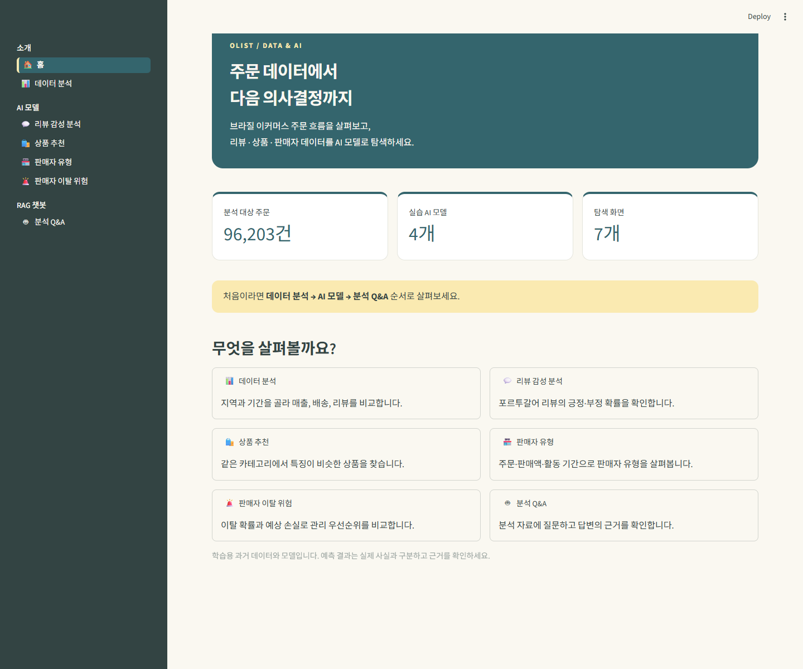
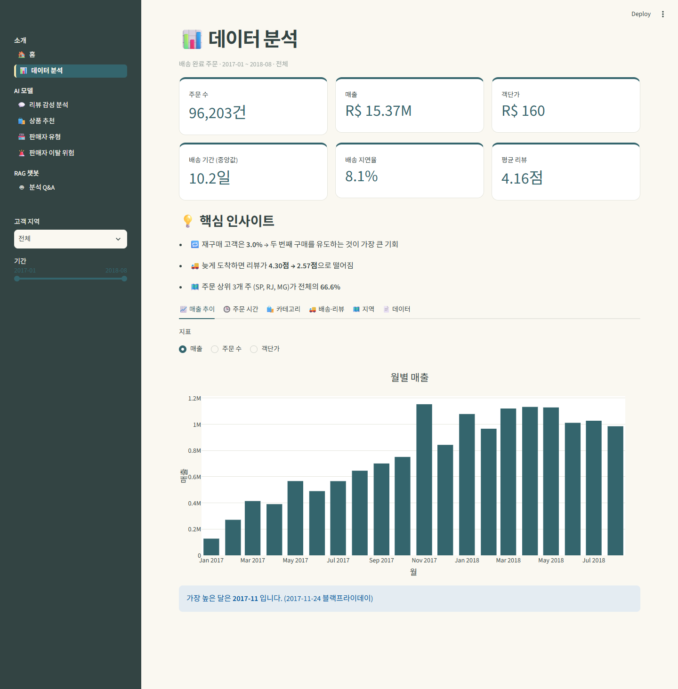
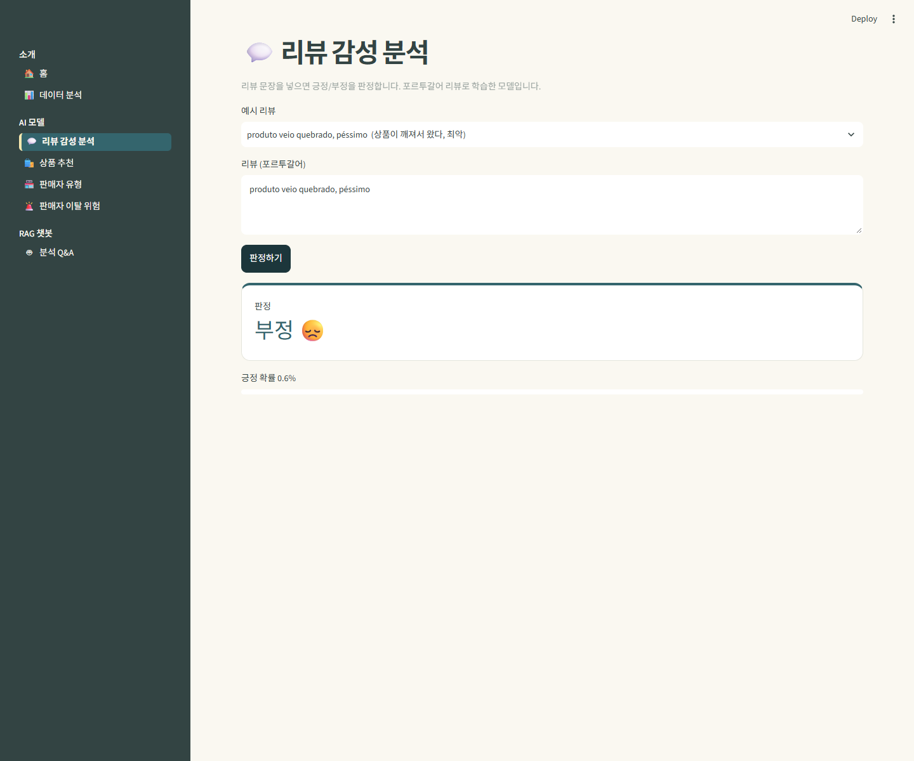
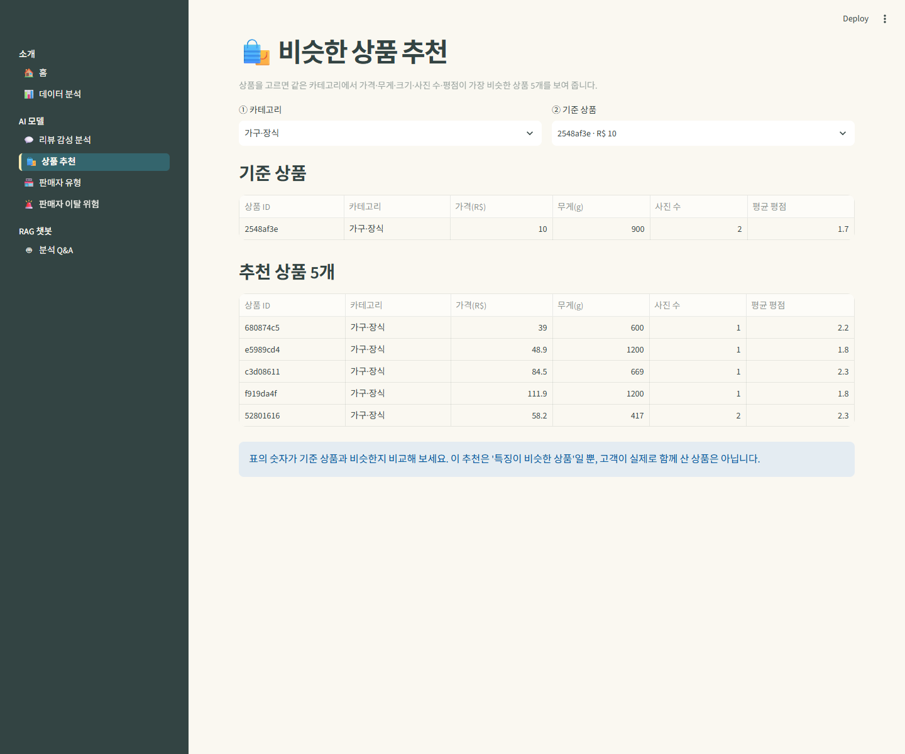
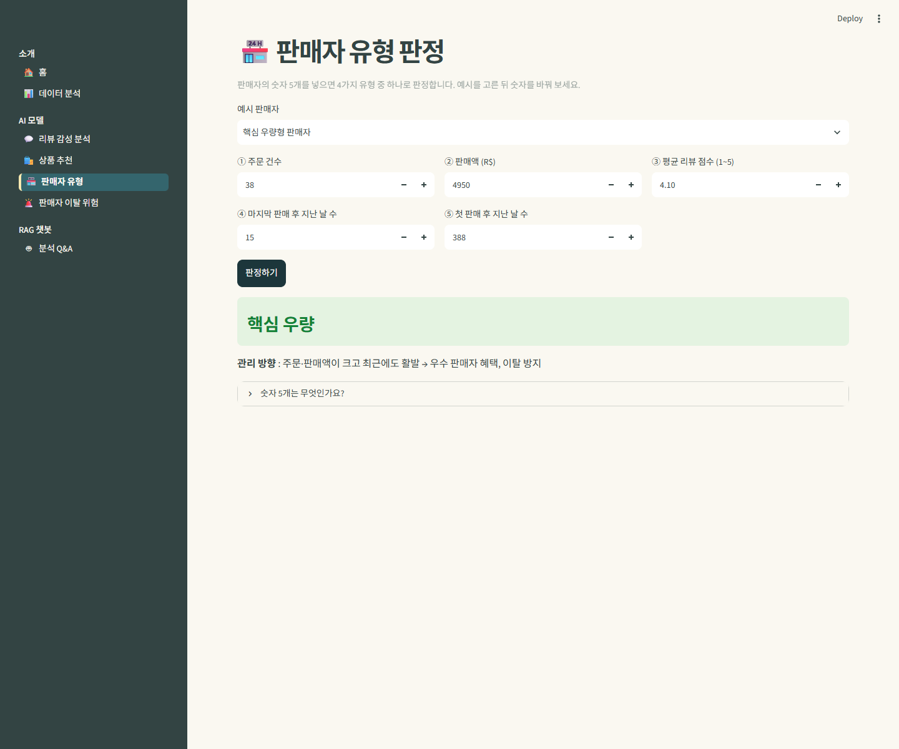
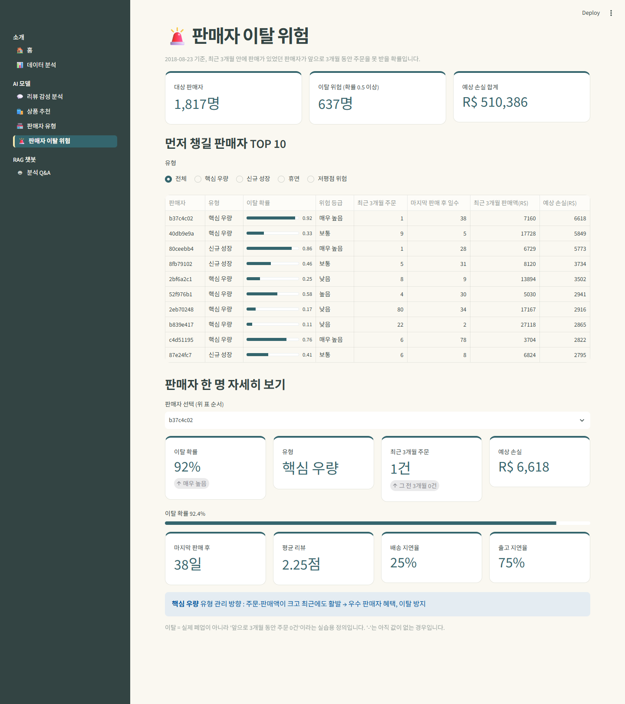
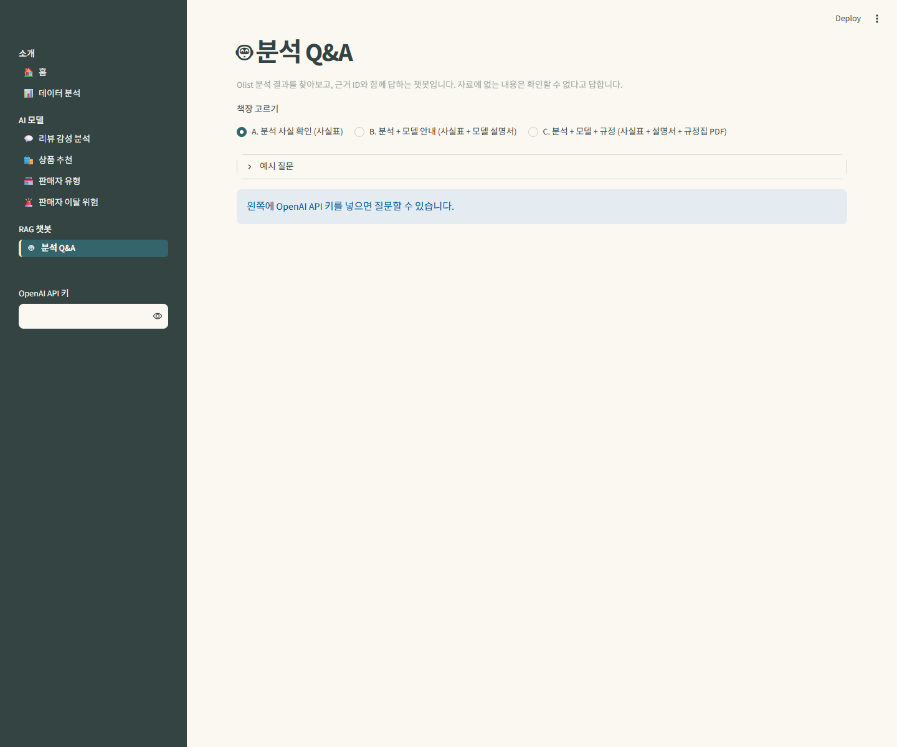

# Olist 데이터 · AI 대시보드

브라질 이커머스 Olist 데이터를 분석하고, 리뷰 감성 분석·상품 추천·판매자 유형·판매자 이탈 위험 모델을 체험하는 Streamlit 학습용 앱입니다. 제공된 `STEP3_Local_Deploy/olist_dashboard`를 기준으로 화면을 개선했습니다.

## 디자인

| 색상 | 용도 |
|---|---|
| `#FAF8F1` | 아이보리 배경 |
| `#FAEAB1` | 안내 영역·선택 메뉴 강조 |
| `#34656D` | 버튼·차트·숫자 강조 |
| `#334443` | 본문·사이드바 |

숫자 지표를 카드로 묶고, 홈에 기능별 바로가기를 배치했습니다. 차트와 입력 요소에도 같은 팔레트를 적용했습니다. 작은 화면에서는 카드가 세로로 배치됩니다.

## 화면별 안내

### 1. 홈

전체 주문 수와 기능별 바로가기를 제공합니다. 주문 수는 포함된 데이터에서 계산합니다.



### 2. 데이터 분석

왼쪽에서 고객 지역과 기간을 선택하면 주문·매출·배송·리뷰 지표가 바뀝니다. 탭에서 매출 추이, 주문 시간, 카테고리, 배송·리뷰, 지역, 원자료를 확인할 수 있습니다.



### 3. 리뷰 감성 분석

포르투갈어 리뷰를 입력하고 **판정하기**를 누르면 긍정·부정 판정과 긍정 확률을 보여 줍니다. 한국어 리뷰용 모델이 아닙니다.



### 4. 상품 추천

카테고리와 기준 상품을 선택하면 같은 카테고리에서 특징이 비슷한 상품 5개를 비교합니다. 실제 동시 구매나 구매 의도를 뜻하지 않습니다.



### 5. 판매자 유형

예시 판매자를 고르고 주문 건수, 판매액, 평점, 활동 기간을 입력합니다. **판정하기**를 누르면 학습된 4가지 유형 중 가까운 유형과 관리 방향을 보여 줍니다.



### 6. 판매자 이탈 위험

과거 데이터 기준 이탈 확률과 예상 손실을 비교하고, 관리 우선순위와 판매자별 세부 지표를 확인합니다. 이탈은 실습에서 정의한 ‘향후 3개월 주문 0건’이며 실제 폐업 여부가 아닙니다.



### 7. 분석 Q&A

사실표·모델 설명서·규정집 중 검색 범위를 골라 질문합니다. OpenAI API 키가 필요하며, 키가 없으면 안내 화면을 보여 줍니다. 아래 이미지는 API 키를 입력하지 않은 화면입니다.



## 실행하기 — Windows PowerShell

저장소를 내려받은 뒤 VS Code에서 폴더를 열고, 터미널에서 다음 순서로 실행합니다.

```powershell
cd olist_dashboard
py -3.12 -m venv .venv-local
.\.venv-local\Scripts\python.exe -m pip install -r requirements.txt
.\.venv-local\Scripts\python.exe -m streamlit run app.py
```

브라우저에서 `http://localhost:8501`을 열면 홈 화면이 나옵니다. 반드시 `olist_dashboard` 폴더에서 실행해야 `.streamlit/config.toml`의 색상 설정을 읽습니다. 새 환경을 만들어 사용하세요. 저장소에 기존부터 포함된 `.venv`는 다른 PC에서 재사용하지 마세요.

검증 환경은 Windows의 Python **3.12.10**, Streamlit **1.66.1**입니다. Python **3.14.7은 실행 검증하지 않았습니다**. 저장된 모델과 scikit-learn 버전의 호환성도 필요하므로, 먼저 위 환경을 권장합니다.

Q&A를 사용하려면 `olist_dashboard/.streamlit/secrets.toml`을 로컬에 만들고 다음 값을 넣습니다. 이 파일과 API 키를 GitHub에 올리지 마세요. 앱의 사이드바에서도 키를 입력할 수 있습니다. API 이용 요금은 별도입니다.

```toml
OPENAI_API_KEY = "본인의 키"
```

## 자료와 결과 확인

- 포함된 자료는 과거 학습용 데이터입니다. 현재 Olist 현황으로 인용하지 마세요.
- 기사에 수치를 사용하기 전 원자료의 출처·기간·필터·집계 기준을 대조하세요. 화면 설명과 AI 예측은 검증된 사실과 구분하세요.
- 판매자 ID는 익명 식별자입니다. 실제 인물과 결합하거나 예측만으로 불이익을 주지 마세요.
- 리뷰와 데이터의 원출처 이용 조건·저작권을 확인하고, 언어·지역·기간에 따른 편향을 점검하세요.
- Q&A 답변의 근거 ID와 원문을 확인하세요. 생성한 답변을 검수 없이 기사로 제출하지 마세요.

## 확인한 범위

- 7개 화면을 브라우저에서 실행하고 오류 표시가 없는지 확인했습니다.
- 감성 분석·판매자 유형은 예시 입력의 판정 결과까지 확인했습니다.
- 상품 추천 표와 판매자 이탈 확률 표가 표시되는 것을 확인했습니다.
- 홈은 가로 390px의 작은 화면에서도 확인했습니다.
- Q&A는 API 키 입력 전 안내 화면만 확인했습니다. 외부 API를 호출하는 답변 생성은 검증하지 않았습니다.
- 이미지는 실제 앱 실행 화면입니다. 데이터 분석 이미지는 기본 필터의 매출 추이 탭입니다.

## 구성

```text
olist_dashboard/
  app.py                   # 앱 시작·메뉴
  .streamlit/config.toml   # 색상 설정
  views/                   # 7개 화면
  utils/theme.py           # 카드·메뉴·차트 공통 디자인
  utils/data.py            # 데이터·차트
  utils/models.py          # 기존 모델 예측
  utils/rag.py             # 근거 기반 Q&A
  data/                    # 제공 데이터
  model/                   # 제공 모델
docs/screenshots/          # 실제 실행 화면
```

테마 설정 참고: [Streamlit 공식 문서](https://docs.streamlit.io/develop/concepts/configuration/theming).
